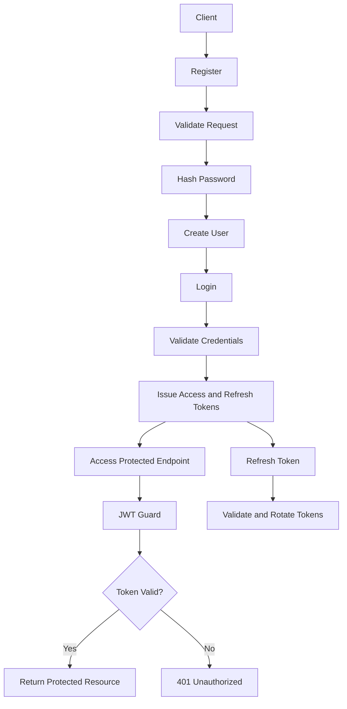

# JWT Authentication API — NestJS

A backend authentication API built with **NestJS, TypeScript, Passport, JWT, and Argon2**. This project implements a secure authentication workflow, request validation, protected endpoints, and interactive API documentation using Swagger.

The project focuses on understanding and implementing authentication fundamentals commonly used in modern backend applications.


## Overview

This API provides an authentication system that allows users to register, log in, receive JSON Web Tokens, access protected resources, refresh their tokens, and log out.

The application uses a modular architecture following NestJS conventions, separating authentication logic, user management, controllers, services, DTOs, and security strategies.

## Tech Stack

- **NestJS** — Backend application framework
- **TypeScript** — Type-safe JavaScript
- **Node.js** — Runtime environment
- **Passport** — Authentication middleware
- **Passport JWT** — JWT authentication strategy
- **JWT** — Stateless access-token authentication
- **Argon2** — Password and refresh-token hashing
- **class-validator** — Request validation
- **class-transformer** — Request transformation
- **Swagger / OpenAPI** — API documentation and interactive testing
- **dotenv / NestJS ConfigModule** — Environment configuration


## Features

### Authentication

- User registration
- User login
- Password hashing with Argon2
- Credential validation
- JWT access-token generation
- JWT refresh-token generation
- Refresh-token validation and rotation
- Logout functionality

### Authorization and Security

- Protected routes using JWT authentication guards
- Bearer token authentication
- Public and protected endpoint separation
- Request validation using DTOs
- Rejection of unexpected request properties
- Passwords stored as hashes rather than plaintext
- Refresh tokens stored as hashes
- JWT signature and expiration validation

### API Documentation

- Interactive Swagger documentation
- Endpoint descriptions
- Request-body schemas
- Response descriptions
- JWT Bearer authentication support

---

## Authentication Flow



### 1. Registration

The client submits an email and password.

The API:

1. Validates the request.
2. Checks whether the email is already registered.
3. Hashes the password using Argon2.
4. Creates the user.
5. Returns the appropriate registration response.

### 2. Login

The client submits credentials.

The API:

1. Finds the user by email.
2. Verifies the password against the stored Argon2 hash.
3. Rejects invalid credentials.
4. Generates an access token and refresh token.
5. Returns the tokens to the client.

### 3. Access Protected Resources

The client sends the access token in the HTTP Authorization header.

```http
Authorization: Bearer <access_token>
```

The JWT authentication strategy verifies the token before allowing access to protected endpoints.

### 4. Token Refresh

When the access token expires, the client can submit its refresh token to the refresh endpoint.

The API validates the refresh token, checks its stored hash, and issues a new token pair through the token-rotation workflow.

### 5. Logout

The API clears the stored refresh-token hash associated with the user.

The access token may remain valid until its expiration time unless additional token-revocation mechanisms are implemented.

---

## API Endpoints

Base URL:

```text
http://localhost:3000/api
```

| Method | Endpoint | Description | Access |
|---|---|---|---|
| POST | `/auth/register` | Register a new user | Public |
| POST | `/auth/login` | Authenticate and receive tokens | Public |
| POST | `/auth/refresh` | Refresh the token pair | Public route; requires valid refresh token |
| GET | `/auth/me` | Retrieve authenticated user information | Protected |
| POST | `/auth/logout` | Log out and clear refresh token | Protected |

> All routes assume the global `api` prefix is configured in the NestJS application.

---

## Project Structure

```text
src/
├── app.controller.ts
├── app.service.ts
├── app.module.ts
├── main.ts
│
├── auth/
│   ├── auth.controller.ts
│   ├── auth.module.ts
│   ├── auth.service.ts
│   ├── decorators/
│   │   └── public.decorator.ts
│   ├── dto/
│   │   ├── register.dto.ts
│   │   ├── login.dto.ts
│   │   └── refresh.dto.ts
│   ├── guards/
│   │   └── jwt-auth.guard.ts
│   └── strategies/
│       └── jwt.strategy.ts
│
└── users/
    ├── users.module.ts
    └── users.service.ts
```

The exact folder structure may vary depending on the generated files and implementation.

---

## Getting Started

### Prerequisites

Make sure you have installed:

- Node.js
- npm
- Git

Check your installations:

```bash
node --version
npm --version
```

### 1. Clone the Repository

```bash
git clone https://github.com/YOUR_USERNAME/day61-auth-lab.git
```

Navigate into the project:

```bash
cd day61-auth-lab
```

### 2. Install Dependencies

```bash
npm install
```

### 3. Configure Environment Variables

Create a `.env` file in the project root.

```env
PORT=3000

JWT_ACCESS_SECRET=your_access_secret
JWT_REFRESH_SECRET=your_refresh_secret
```

Generate secure secrets using OpenSSL:

```bash
openssl rand -base64 48
```

Generate separate secrets for access tokens and refresh tokens.

Never commit your actual secrets to GitHub.

### 4. Start the Development Server

```bash
npm run start:dev
```

The application should run at:

```text
http://localhost:3000
```

---

## Swagger API Documentation

Interactive API documentation is available at:

```text
http://localhost:3000/api/docs
```

Swagger provides an interface to:

- Explore authentication endpoints
- Review request schemas
- Submit registration requests
- Test login
- Inspect responses
- Authorize protected endpoints using JWT Bearer tokens

### Testing Protected Endpoints with Swagger

1. Register a user using `POST /auth/register`.
2. Log in using `POST /auth/login`.
3. Copy the returned access token.
4. Click the **Authorize** button in Swagger.
5. Enter your access token.
6. Execute `GET /auth/me` or another protected endpoint.

Swagger will send the token using the Authorization header.

---

## Example API Requests

### Register

```http
POST /api/auth/register
Content-Type: application/json
```

```json
{
  "email": "user@example.com",
  "password": "StrongPassword123"
}
```

### Login

```http
POST /api/auth/login
Content-Type: application/json
```

```json
{
  "email": "user@example.com",
  "password": "StrongPassword123"
}
```

### Authenticated Request

```http
GET /api/auth/me
Authorization: Bearer <access_token>
```

### Refresh Token

```http
POST /api/auth/refresh
Content-Type: application/json
```

```json
{
  "refreshToken": "<refresh_token>"
}
```

---

## Request Validation

The application uses NestJS `ValidationPipe` with the following configuration:

```typescript
app.useGlobalPipes(
  new ValidationPipe({
    whitelist: true,
    forbidNonWhitelisted: true,
    transform: true,
  }),
);
```

### Validation Behavior

- `whitelist` removes properties that do not have validation decorators.
- `forbidNonWhitelisted` rejects unexpected properties instead of silently accepting them.
- `transform` converts incoming data to DTO-defined types where applicable.

DTOs are used to validate incoming registration, login, and refresh-token requests.

---

## Security Implementation

### Password Hashing

Passwords are hashed using Argon2 before being stored.

Plaintext passwords are never intentionally stored in the user record.

### JWT Access Tokens

Access tokens are used to authenticate requests to protected endpoints.

They contain claims such as:

- User ID (`sub`)
- Email
- Roles
- Expiration time

### Refresh Tokens

Refresh tokens are used to obtain new access tokens without requiring the user to log in again.

The implementation hashes refresh tokens before storage and validates them during the refresh process.

### Authentication Guards

JWT guards protect endpoints from unauthorized access.

Requests without valid tokens, invalid signatures, or expired tokens are rejected.

---

## Error Handling

The API uses NestJS HTTP exceptions to return appropriate responses.

| Status | Meaning |
|---|---|
| `201` | Resource successfully created |
| `200` | Request successful |
| `400` | Invalid request or validation error |
| `401` | Unauthorized or invalid credentials |
| `404` | Route or resource not found |
| `409` | Conflict, such as an already registered email |
| `500` | Internal server error |

---

## Development Scripts

| Command | Description |
|---|---|
| `npm run start` | Start the application |
| `npm run start:dev` | Start in development/watch mode |
| `npm run start:debug` | Start in debug/watch mode |
| `npm run start:prod` | Run the compiled application |
| `npm run build` | Compile the application |
| `npm run test` | Run unit tests |
| `npm run test:e2e` | Run end-to-end tests |
| `npm run test:cov` | Generate test coverage |

---

## Current Limitations

This project is a learning implementation of authentication fundamentals and is not yet a production-ready identity system.

- User data is stored in memory and is lost when the application restarts.
- No persistent database integration yet.
- Refresh-token storage is simplified and does not provide full multi-device session management.
- Access tokens are not immediately revoked on logout.
- Rate limiting and brute-force protection are not implemented.
- Email verification and password-reset workflows are not implemented.
- Refresh-token reuse detection and session-family revocation are not implemented.

These limitations provide opportunities for future improvements.

---

## Future Improvements

- Integrate PostgreSQL with TypeORM or Prisma.
- Implement persistent user management.
- Add role-based access control (RBAC).
- Add rate limiting and brute-force protection.
- Implement email verification.
- Implement password reset.
- Add multi-device session management.
- Add refresh-token reuse detection.
- Add automated unit and integration tests.
- Add Docker support.
- Implement secure cookie-based refresh-token handling where appropriate.

---

## Learning Objectives

This project demonstrates practical understanding of:

- Backend API development using NestJS
- Modular architecture and dependency injection
- Authentication and authorization fundamentals
- Password hashing and credential validation
- JWT creation and verification
- Access-token and refresh-token workflows
- Passport authentication strategies
- Guards and protected routes
- DTOs and request validation
- API documentation with Swagger
- Environment-based configuration
- HTTP status codes and error handling

---

## Author

**Backend Development Practice Project**

Built as part of backend engineering learning and practical API development with NestJS, TypeScript, and JWT authentication.

---

## License

This project is intended for educational and portfolio purposes. Add a license file if you plan to distribute or reuse the project publicly.
